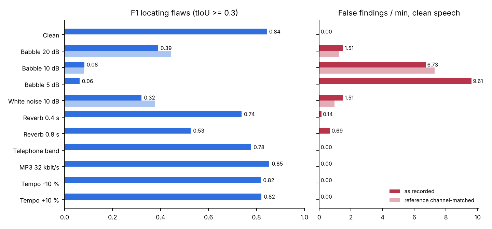

# SpeechLens

**Contrastive speech analytics with temporal flaw grounding.**
Multimodal AI Hackathon 2026, Track C.

**Live demo: https://rishinavroop22.github.io/speechlens/** (every dataset clip with its full report, the counterfactual "Hear it fixed" audio, and the complete evaluation; analysing your own recordings needs the full app below)

SpeechLens compares a participant's spoken delivery against a well-delivered reference reading of the *same transcript*. It aligns both readings word by word, measures how pace, pausing, pitch, loudness, articulation and fluency differ, marks every delivery flaw with exact start and end times, and explains each one with the numbers behind it and a concrete fix. A rubric turns the findings into a reproducible score.

It is trained and tested on a **contrastive dataset we built**: five public-domain presidential speeches, each mirrored by a graded spectrum of flawed recordings of the same words, from near-perfect to egregious, with sample-exact labels.

| | |
|---|---|
| Dashboard | upload or record audio, see flaw regions on a time-aligned overlay, A/B-listen participant vs reference, hear each flaw repaired |
| Dataset | 5 gold speeches, 285 synthetic clips (incl. 20 controls), 36 team recordings with scripted flaws |
| Flaw types | rushed, dragging, monotone, trailing off, missing pauses, awkward pause, filler, muffled articulation, repeated onset |
| Runs on | CPU only, no GPU, no cloud API, no language model; identical output on every run |

---

## Quick start

```bash
git clone <this repo> && cd speechlens
python -m venv .venv && source .venv/bin/activate      # Windows: .venv\Scripts\activate
pip install -r requirements.txt
python tools/get_model.py                               # downloads the 378 MB alignment model
uvicorn speechlens.app:app --port 8000                  # open http://localhost:8000
```

Prerequisites: Python 3.10+, `ffmpeg` on PATH (for MP3/M4A input). With Docker instead:

```bash
docker build -t speechlens . && docker run -p 8000:8000 speechlens
```

The dataset audio is distributed separately (see [Dataset](#dataset)); unpack it into `data/` to use the sample clips and re-run the evaluation.

### Command line

```bash
# score one recording against a reference
python -m speechlens.cli reference.wav reference.txt participant.m4a --rubric declamation

# rebuild the dataset from raw speeches in data/raw/
python tools/build_dataset.py --excerpt-sec 75

# reproduce every number in the evaluation section
python tools/evaluate.py --workers 2
```

---

## How it works

```
reference audio + transcript ─┐                          ┌─> regions (type, start, end, severity, z, metrics)
                              ├─ forced alignment ─ features ─ word-paired contrast ─┼─> causal explanations
participant audio (+ text) ───┘   (wav2vec2 CTC)   (10 ms grid)                       └─> rubric score 0-100
```

1. **Forced alignment.** `wav2vec2-base-960h` (ONNX, CPU) produces per-frame character probabilities; an exact CTC Viterbi pass finds the single path that spells the transcript, giving every word a start and end. Boundaries are refined against the energy envelope so word tails and pauses are measured from real silence.
2. **Feature extraction** on a shared 10 ms grid: F0 (two-pass, speaker-adaptive range), intensity, harmonics-to-noise ratio, spectral energy above 2 kHz and 4 kHz, spectral flux, MFCCs. Aggregated per word: articulation rate, pause after, voiced sound inside pauses, pitch range, loudness, articulation energy, recognizer confidence.
3. **Speaker normalization.** Pitch is in semitones relative to each speaker's own median F0 and loudness in dB relative to each speaker's median speech level, so a deep and a high voice reading identically produce the same contours, and recording gain is irrelevant.
4. **Word-paired contrast.** Words of the two readings are paired by transcript position. Each contrast signal is split into a *global* offset (the speaker's overall habit, reported separately) and a *local* deviation, scored as a robust z-score against the reference speaker's own word-to-word variability, smoothed, thresholded and merged into regions.
5. **Causal explanation.** Each region becomes a sentence filled from measured values: what changed, by how much, how unusual that is, why it hurts delivery, and how to fix it. No language model is involved.
6. **Rubric scoring.** Six dimensions (pace, pausing, fluency, pitch variety, volume control, clarity) start at 10 and lose points per region by severity and coverage. Presets weight them for Declamation, Interpretive Reading, Extemporaneous and Persuasive Oratory.

Full detail, formulas and thresholds: [`docs/methodology.md`](docs/methodology.md).

---

## Dataset

### Gold baseline
Opening excerpts (73-110 s) of five speeches, all US federal government works in the public domain, audio and transcripts from the Miller Center, University of Virginia:

| id | Speech | Year |
|---|---|---|
| `fdr` | Franklin D. Roosevelt, address to Congress ("Day of Infamy") | 1941 |
| `jfk` | John F. Kennedy, Inaugural Address | 1961 |
| `lbj` | Lyndon B. Johnson, voting rights ("We Shall Overcome") | 1965 |
| `reagan` | Ronald Reagan, Challenger address | 1986 |
| `obama` | Barack Obama, Inaugural Address | 2009 |

### The bad spectrum
**Synthetic (exact labels).** The Flaw Injection Engine (`speechlens/inject.py`) edits the gold recording with Praat PSOLA resynthesis, which changes timing and pitch while keeping the speaker's own voice. Because we make every edit ourselves, each label is exact to the sample. Per speech:
- 45 single-flaw clips: 9 flaw types x 5 severities (1 = near-perfect, 5 = egregious);
- 8 mixed clips forming a gradient from two mild flaws to six severe ones;
- 4 controls with no flaw: the untouched gold, the voice shifted +4 and -4 semitones, and 12 dB quieter.

**Human (scripted labels).** Team members read three of the excerpts four times each: one clean take and three takes with flaws performed at positions fixed by a recording script ([`docs/recording_sheet.md`](docs/recording_sheet.md)). Labels come from aligning each take and mapping the scripted words to times.

### Files
```
data/library/<id>/      audio.wav, transcript.txt, alignment.json, meta.json
data/dataset/clips/     <clip>.wav
data/dataset/labels/    <clip>.json   labels + word timings of the flawed recording
data/dataset/manifest.json
```
Audio download: see the link in [`data/README.md`](data/README.md).

---

## Evaluation

All numbers run the full pipeline on raw audio. Detection thresholds and severity tables are fitted from data, so results are **cross-validated**: synthetic clips with thresholds fitted without that speech, team recordings with thresholds fitted without that recorder.

| | |
|---|---|
| Locating synthetic flaws (tIoU >= 0.3, leave-one-speech-out) | **F1 0.70**, precision 0.89, recall 0.58 |
| Temporal accuracy of located flaws | mean tIoU 0.75, median boundary error **156 ms** |
| False findings on unflawed controls (incl. voice ±4 semitones, -12 dB) | **0.034 per minute** |
| Score vs mixed-flaw level | Spearman **ρ = -0.95** |
| Severity estimate, held-out speeches | 0.453 levels mean error, 94 % within one level |
| Team recordings: performed flaws found (leave-one-speaker-out) | **55 %** (32/58) |
| Team recordings: precision | 0.22 against scripted flaws only; about **0.80** (95 % range 0.61-0.92) after a blind listening audit |
| Re-run in a fresh process | byte-identical |

| Flaw | Synthetic P | Synthetic R | Synthetic F1 | Team recordings found |
|---|---|---|---|---|
| Rushed | 0.97 | 0.73 | 0.83 | 4/8 |
| Dragging | 0.88 | 0.52 | 0.66 | 5/5 |
| Monotone | 1.00 | 0.64 | 0.78 | 2/4 |
| Trailing off | 0.96 | 0.63 | 0.77 | 2/2 |
| Missing pauses | 1.00 | 0.51 | 0.68 | 4/8 |
| Awkward pause | 0.94 | 0.60 | 0.73 | 5/7 |
| Filler | 0.80 | 0.62 | 0.70 | 8/15 |
| Muffled articulation | 1.00 | 0.52 | 0.69 | 0/2 |
| Repeated onset | 0.75 | 0.44 | 0.56 | 2/7 |
| **All flaws** | 0.89 | 0.58 | 0.70 | 32/58 |

**Team recordings.** Each flawed take is compared with the same person's clean take. A manipulation check, with fixed criteria independent of the detector, found that 58 of 90 scripted flaws were actually performed (phone gain control erased most fades, and "mumbles" were usually whispered); only those are scored. Findings outside a scripted flaw count as false, yet in a blind listening audit 12 of 16 of them were heard as genuinely worse delivery, against 0 of 7 random spans. The listener named the same problem as the detector in only 17 % of those cases: SpeechLens locates unscripted problems more reliably than it labels them.

### Why the reference matters (ablations, `tools/ablate.py`)

The same detector on the same alignments and features with one component removed. The **reference-free baseline** keeps the whole detector but compares each passage with the speaker's own running median instead of a reference reading, which is how delivery tools work when there is no reference.

| Variant (in-sample thresholds) | P | R | F1 | Controls, false/min | Human P | Human R |
|---|---|---|---|---|---|---|
| **SpeechLens (full)** | 0.91 | 0.59 | **0.72** | **0.03** | 0.24 | 0.57 |
| Without data-fitted gates | 0.78 | 0.70 | 0.74 | 0.03 | 0.11 | 0.64 |
| Without conflict rules | 0.83 | 0.60 | 0.69 | 0.03 | 0.20 | 0.59 |
| Without habit / local split | 0.92 | 0.59 | 0.71 | 0.03 | 0.20 | 0.48 |
| Without speaker-relative scale | 0.90 | 0.51 | 0.65 | 0.03 | 0.18 | 0.48 |
| Reference-free baseline | 0.05 | 0.33 | 0.08 | 9.58 | 0.10 | 0.36 |
| Reference-free, thresholds tuned on the test labels | 0.12 | 0.27 | 0.16 | 2.68 | 0.19 | 0.21 |

Without a reference, ordinary expressive variation (a rhetorical pause, an emphatic slow phrase) looks like a flaw; even an upper-bound tuning on the evaluation labels reaches F1 0.16.

### Counterfactual check (`tools/counterfactual_eval.py`)

Each explanation names one cause. We change exactly that variable in the participant's own recording (PSOLA time-scaling or pitch widening, a per-word gain curve, a high shelf, cutting or reinserting audio), moving it to the reference value, and run the full pipeline again. Over 73 severity-3/4 flaws that were found, the **finding disappeared in 90 %** and was reduced or removed in 93 %; a new finding appeared nearby in 1.4 %. Mean score rose from 93.0 to 98.4. Muffled speech is the exception (1 of 8): a low-pass filter destroys the high band, so it cannot be restored. The dashboard offers the same repair as **Hear it fixed**.

### Stress test (`tools/stress.py`)

The reference stays the clean speech; only the participant recording is degraded, as with a phone in a noisy room. 55 clips per condition: every severity-4 single flaw, the level-6 mixed clips, and each clean speech as a null (any finding on it is false). Babble is the other four speeches mixed together.



| Condition | P | R | F1 | False/min on clean speech | Word onset shift |
|---|---|---|---|---|---|
| Clean | 0.90 | 0.79 | **0.84** | 0.00 | 0 ms |
| MP3 32 kbit/s | 0.92 | 0.80 | 0.85 | 0.00 | 0 ms |
| Tempo -10 % / +10 % (whole reading) | 0.89 / 0.91 | 0.76 / 0.75 | 0.82 / 0.82 | 0.00 | 9 / 7 ms |
| Telephone band (8 kHz, 300-3400 Hz) | 0.82 | 0.74 | 0.78 | 0.00 | 0 ms |
| Reverb RT60 0.4 s / 0.8 s | 0.75 / 0.48 | 0.73 / 0.58 | 0.74 / 0.53 | 0.14 / 0.69 | 20 / 30 ms |
| White noise, SNR 10 dB | 0.24 | 0.47 | 0.32 | 1.51 | 20 ms |
| Babble, SNR 20 / 10 / 5 dB | 0.30 / 0.05 / 0.04 | 0.56 / 0.27 / 0.24 | 0.39 / 0.08 / 0.06 | 1.5 / 6.7 / 9.6 | 0 / 20 / 60 ms |

Compression, a phone channel, a uniformly faster or slower reading and moderate echo barely matter: the alignment stays within tens of milliseconds and the habit/local split absorbs a uniform tempo change. **Background noise is the weakness.** Noise fills the pauses and the quiet ends of words, so the contrast with a clean reference reports shorter pauses, longer words and held sounds that are really the room. Putting the reference through the participant's estimated noise channel (`speechlens/channel.py`) recovers only part of it (babble 20 dB: F1 0.39 → 0.44; white noise: 0.32 → 0.38, false findings 1.5 → 1.0 per minute). The app therefore measures both noise floors and, when the participant is more than 6 dB noisier (no recording in our dataset is), applies that matching and **warns that the result is unreliable**.

Reproduce everything with `./reproduce.sh`. Full write-up: [`docs/SpeechLens_Technical_Documentation.pdf`](docs/SpeechLens_Technical_Documentation.pdf).

## Limitations

- The reference must read the same text; without one, detection collapses (see the reference-free baseline above).
- Background noise in the participant's recording that the reference does not have breaks the comparison (stress test above). The dashboard measures both noise floors and warns when the participant is more than 6 dB noisier.
- Synthetic flaws are cleaner than human ones; human-recording results are reported separately for that reason.
- Muffled articulation is measured through high-frequency energy, so a low-pass microphone or heavy compression can mimic it. The global/local split absorbs a constant channel difference but not one that changes mid-recording.
- Fillers and repeated onsets are found inside pauses; a filler fused into a word with no gap can be missed.
- The alignment model is English-only.
- Thresholds were set on the synthetic data, and human recordings are the out-of-distribution check.

## Attributions

- Speech audio and transcripts: Miller Center, University of Virginia; the speeches are US federal government works (public domain).
- Alignment model: [facebook/wav2vec2-base-960h](https://huggingface.co/facebook/wav2vec2-base-960h) (Apache-2.0), ONNX export by [Xenova](https://huggingface.co/Xenova/wav2vec2-base-960h).
- Praat via [Parselmouth](https://github.com/YannickJadoul/Parselmouth) (GPL-3.0); librosa (ISC); onnxruntime (MIT); FastAPI (MIT).
- Font: Archivo (SIL Open Font License).
